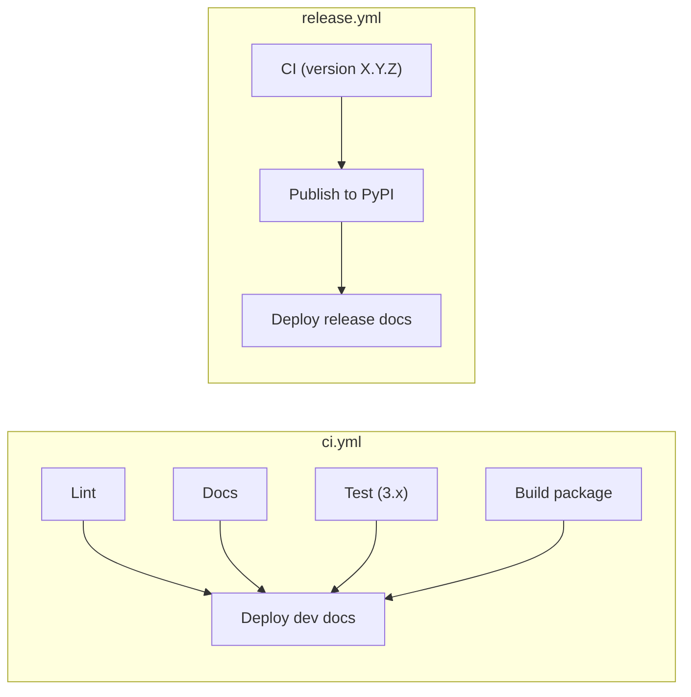

# CI workflow design

This document specifies the GitHub Actions setup of this repository: which workflows exist, what starts them, which
jobs and steps they run and which permissions each job gets. It is written for maintainers who change the workflows or
copy them into a new project.

## Goals

- Pull requests get fast feedback with a read-only token and never publish anything.
- A push to `main` publishes the dev documentation only after every check passed, and publishes the commit that was
  tested.
- A version tag publishes the package and the release documentation only after every check passed.
- Each job gets only the permissions it needs.
- Workflow, job and step names read well in the pull request checks list, the run logs and the README badges. Steps
  that do the same thing have the same name in every workflow.

## Problems in the previous setup

| Problem | Where |
|---------|-------|
| Dev docs are published even when the tests fail: `workflow_run` with `types: completed` doesn't check the result. | `CI_publish_dev_documentation.yaml` |
| Dev docs are built from the newest `main` commit, not from the tested one. | `CI_publish_dev_documentation.yaml` |
| The `branches: ['main']` filter of `workflow_run` also matches pull requests from forks with a branch named `main`. | `CI_publish_dev_documentation.yaml` |
| Dev docs are published to the site root with `keep_files: true`, so files removed from the dev docs stay forever and mix with the version folders. | `CI_publish_dev_documentation.yaml` |
| The test matrix lists Python 3.10, which `requires-python` excludes; Poetry falls back to 3.12, so the job tests 3.12 twice. | `CI_test.yaml` |
| Docs build, pylint and mypy run once per Python version. | `CI_test.yaml` |
| mypy passes with up to 5 errors, counted with `grep`. | `CI_test.yaml` |
| No `permissions` block; the repository default gives pull request runs a write token. | `CI_test.yaml` |
| PyPI upload and docs deploy share one job with `id-token: write` and `contents: write`. | `CI_publish.yaml` |
| `pages: write` is unused: Pages serves from the `gh-pages` branch, not from an Actions deployment. | both publishing workflows |
| The same work has different step names, for example `Install poetry` and `Install poetry and python package`. | all |
| File names repeat a `CI_` prefix; the only test job is called `pipeline`. | all |

## Documentation site layout

The `gh-pages` branch holds:

| Path | Content | Written by |
|------|---------|------------|
| `index.html` | redirect to `stable/`, or to `dev/` while no release exists | `update_version_index.py` |
| `_static/switcher_config.json` | version switcher: dev, then every release with the newest marked stable | `update_version_index.py` |
| `dev/` | documentation of the newest `main` commit | dev docs deploy |
| `X.Y.Z/` | documentation of release `X.Y.Z` | release docs deploy |
| `stable/` | copy of the newest `X.Y.Z/` | `update_version_index.py` |

Every documentation build sits one folder below the root, so all builds read the switcher from
`../_static/switcher_config.json`. That path becomes the default in `doc/conf.py`, and the
`VERSION_SWITCHER_CONFIG_URL` variable is removed.

`update_version_index.py` changes in two ways: the `dev` switcher entry points to `dev/`, and the script writes the root
`index.html` redirect.

## Workflows

| File | Name | Starts on |
|------|------|-----------|
| `.github/workflows/ci.yml` | `CI` | pull request, push to `main`, call from `release.yml` |
| `.github/workflows/release.yml` | `Release` | push of a tag `X.Y.Z` |
| `.github/dependabot.yml` | – | weekly update check for the actions used in the workflows |

CodeQL keeps running through the repository's default code scanning setup and has no workflow file.

`Deploy dev docs` runs only on a push to `main`.

### ci.yml

Workflow settings:

- `permissions: contents: read`
- `concurrency`: group `${{ github.workflow }}-${{ github.ref }}`; cancels the older run for pull requests only, so
  every `main` commit finishes and can deploy.
- Input `version` (only through `workflow_call`): the version of the package and documentation to build. Without it,
  the package version is `0.0.0.dev<run number>+<short commit hash>`, which identifies the run and commit a package
  came from, and the documentation version is `dev`.

| Job id | Display name | Needs | Extra permissions |
|--------|--------------|-------|-------------------|
| `lint` | `Lint` | – | – |
| `docs` | `Docs` | – | – |
| `test` | `Test (3.x)` | – | – |
| `build` | `Build package` | – | – |
| `deploy-docs` | `Deploy dev docs` | `lint`, `docs`, `test`, `build` | `contents: write` |

- `lint` runs pylint and mypy and fails on any finding.
- `docs` builds with the `version` input or `dev` and `--fail-on-warning` and uploads the site as artifact `docs`.
- `test` runs pytest with coverage on `test` and `.github/scripts`, once per Python version in `requires-python`.
- `build` sets the package version, builds the package and uploads `dist/` as artifact `dist`. On pull requests and
  `main` this checks that the package builds; on a release it is the package that gets published.
- `deploy-docs` downloads the `docs` artifact and publishes it to folder `dev`, so it publishes exactly what `docs`
  built and checked. It runs only when `github.event_name == 'push' && github.ref == 'refs/heads/main'`; the ref check
  is needed because a run called from `release.yml` also has event `push`, with the tag as ref.

`lint`, `docs` and `build` run on the default Python version only.

### release.yml

Workflow settings: `permissions: contents: read`.

| Job id | Display name | Needs | Extra permissions |
|--------|--------------|-------|-------------------|
| `ci` | `CI` | – | `contents: write`, see below |
| `pypi` | `Publish to PyPI` | `ci` | `id-token: write`, environment `pypi` |
| `deploy-docs` | `Deploy release docs` | `ci`, `pypi` | `contents: write` |

- `ci` calls `ci.yml` with the tag as `version`. Its `docs` and `build` jobs build the release documentation and
  package, so a release whose checks fail or whose package doesn't build publishes nothing. A called workflow can't
  request more permissions than its caller grants, so `ci` grants `contents: write` for the dev `deploy-docs` job of
  `ci.yml`, which is skipped for tags. Without that grant the workflow fails to start.
- `pypi` downloads the `dist` artifact of the called CI run and uploads it with `pypa/gh-action-pypi-publish`, which
  authenticates through PyPI's trusted publishing. It is skipped outside the `MeteoSwiss` organization, because forks
  have no trusted publisher.
- `deploy-docs` downloads the `docs` artifact of the called CI run and publishes it to folder `X.Y.Z`, so a release
  publishes exactly the documentation that CI built and checked. It waits for `pypi`, so no documentation appears for
  a version that isn't on PyPI. A skipped dependency skips its dependents, so in a fork `deploy-docs` would never run;
  `if: ${{ !failure() && !cancelled() }}` lets it run after a skipped `pypi` but not after a failed one.

## Steps

Steps that do the same thing use the same name and the same implementation in every job:

| Step name | Does | Used in |
|-----------|------|---------|
| `Check out repository` | `actions/checkout` | every job |
| `Set up Python and Poetry` | composite action `setup-python-poetry` | `lint`, `docs`, `test`, `build` |
| `Run pylint` | `poetry run pylint open_source_template` | `lint` |
| `Run mypy` | `poetry run mypy` | `lint` |
| `Run tests` | `poetry run pytest` with coverage | `test` |
| `Build documentation` | `poetry run sphinx-build` with `VERSION` and `BUILD_ID` | `docs` |
| `Upload documentation` | `actions/upload-artifact`, artifact `docs` | `docs` |
| `Download documentation` | `actions/download-artifact`, artifact `docs` | both `deploy-docs` jobs |
| `Set package version` | `poetry version` with the `version` input or the dev version | `build` |
| `Build package` | `poetry build` | `build` |
| `Upload package` | `actions/upload-artifact`, artifact `dist` | `build` |
| `Download package` | `actions/download-artifact`, artifact `dist` | `pypi` |
| `Publish package` | `pypa/gh-action-pypi-publish` | `pypi` |
| `Publish documentation` | composite action `publish-docs` | both `deploy-docs` jobs |

Each `deploy-docs` job joins the `gh-pages` concurrency group without cancelling, so two deploys never push to
`gh-pages` at the same time. GitHub keeps at most one waiting job per group: when a third deploy arrives while one runs
and one waits, the waiting one is cancelled. For dev docs the newest commit wins, which is the intended result. A
cancelled release deploy is rerun from the `Release` run.

### Composite actions

Work that repeats across jobs lives in local composite actions, so it is defined once:

- `.github/actions/setup-python-poetry/action.yml` installs a pinned Poetry version with `pipx`, sets up Python with
  the Poetry dependency cache and runs `poetry install`. It takes the Python version as an optional input; the default
  comes from `.python-version`. `docs` and `build` turn the cache off, because their output gets published on a
  release and a poisoned cache entry would end up in it.
- `.github/actions/publish-docs/action.yml` takes the built site and a folder name (`dev` or `X.Y.Z`). It checks out
  `gh-pages`, replaces the folder, runs `update_version_index.py`, and commits and pushes when something changed.
  Dev and release docs publish the same way, so the switcher, `stable/` and the root redirect are correct after every
  deploy.

The test matrix lists exactly the minor versions allowed by `requires-python` in `pyproject.toml`.

## Renames and removed files

| Before | After |
|--------|-------|
| `CI_test.yaml` (`CI_test`), job `pipeline` | `ci.yml` (`CI`), jobs `lint`, `docs`, `test`, `build` |
| `CI_publish_dev_documentation.yaml` | removed; its work is job `deploy-docs` in `ci.yml` |
| `CI_publish.yaml` (`CI_publish`), job `publish` | `release.yml` (`Release`), jobs `pypi`, `deploy-docs`; the package and documentation builds move to `ci.yml` |

The README badges for `CI_test` and `CI_publish_dev_documentation` become badges for `ci.yml` and `release.yml`. The
README release procedure names `Release` instead of `CI_publish`.

## Repository settings

These settings live outside the repository files and are changed by a maintainer:

- Default workflow permissions: read. The workflows grant write access per job.
- Ruleset for `main`: require pull requests and the checks `Lint`, `Docs`, `Build package` and every `Test (3.x)`.
- GitHub environment `pypi`, optionally limited to tags matching `X.Y.Z`.
- PyPI trusted publisher of `open-source-template`: repository `MeteoSwiss/Open-Source-Template`, workflow
  `release.yml`, environment `pypi`. A PyPI owner or maintainer changes it under
  <https://pypi.org/manage/project/open-source-template/settings/publishing/>.
- The unused environment `github-pages` can be deleted.

## Migration

After the workflow changes are merged, a maintainer:

1. Updates the PyPI trusted publisher and creates the `pypi` environment, as listed above. Until then, PyPI rejects
   the upload of the next release: the existing publisher names the deleted workflow `CI_publish.yaml` and no
   environment.
2. Cleans up `gh-pages` once: removes the dev documentation files from the root, keeping the version folders, `stable/`,
   `_static/switcher_config.json` and `.nojekyll`. The next deploy writes the root redirect and `dev/`.
3. Changes the other repository settings listed above.

The move to Python 3.14 follows as a separate change and only touches `pyproject.toml`, `poetry.lock`,
`.python-version` and the matrix.
